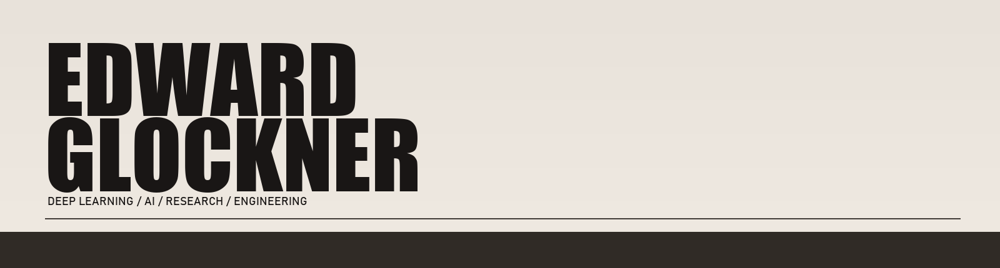

  

  Interested in deep learning and AI across research and engineering.

## Selected Work

- [Exploiting the Asymmetric Uncertainty Structure of Pre-trained VLMs on the Unit Hypersphere](https://github.com/EdwardGlockner/asymvlm) (NeurIPS 2025)
- [DeadBase: an AI coaching agent for Deadlock](https://github.com/EdwardGlockner/DeadBase) (WIP, more coming soon)

## Links

- [LinkedIn](https://www.linkedin.com/in/edwardglockner/)
